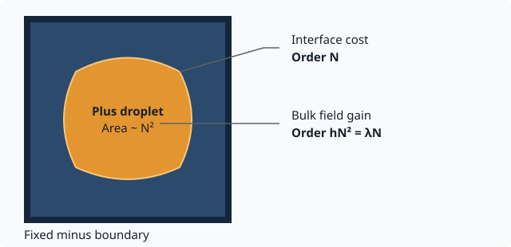

# Ising dynamics in a competing magnetic field

A Monte Carlo simulator for the 2-D Ising model in a box of size $N$ with fixed minus boundary conditions and a positive external field $h_N=\lambda/N$. At this scaling of the external field, for a droplet of positive spins of size of the same order as the box, the interface cost and field gain to the energy are both of order $N$ as well, motivating studies of metastability, droplet geometry, boundary-layer fluctuations and mixing times.

The project implements sequential random-site heat-bath and Metropolis dynamics, with both Python and Numba backends, as well as ghost-based (`sw-ghost`) and size-based (`sw-size`) Swendsen–Wang cluster updates, each with SciPy and Numba backends. It includes replicated experiments and statistical tools for interpreting their results.



## Interactive demonstration

Open [the standalone HTML demo](docs/index.html) in a browser (no Python installation or internet connection required). Adjust the field, inverse temperature, lattice size and dynamics; pause or step through the evolution while observing magnetization and the largest plus cluster.

## Installation

Use Python 3.10 or newer. From the repository root, create and activate a virtual environment.

**Windows PowerShell**

```powershell
python -m venv .venv
.\.venv\Scripts\Activate.ps1
python -m pip install -e .
```

**Linux / macOS**

```bash
python -m venv .venv
source .venv/bin/activate
python -m pip install -e .
```

Installation resolves the dependencies declared in `pyproject.toml`. In VS Code, select the virtual environment as your Python interpreter.

## Jupyter notebooks

From the repository root in your activated environment:

```bash
python -m pip install -e ".[notebook]"
python -m jupyterlab
```

Start with [Introduction](notebooks/01_introduction.ipynb). Select your installed environment as the kernel. See [notebook guide](notebooks/README.md) for details.

## Quick start

```bash
ising --help
ising series --size 64 --beta 0.5 --field 3 --sweeps 100
ising movie --size 64 --beta 0.5 --field 3 --output bubble.gif
```

`python -m ising` is equivalent to `ising`. Use `ising COMMAND --help` for command-specific options. The field option specifies $\lambda$, not $h_N$.

### Python API

```python
from ising import IsingModel, Simulator

model = IsingModel(N=64, beta=0.5, lam=3)
sim = Simulator(model, dynamics="heatbath", backend="numba", init="minus", seed=42)
sim.advance(100)  # 100 sweeps = 100 * N**2 attempted local updates
print(sim.observe(contours=True, interface_heights=True))
```

The Python and Numba local backends execute the same sequential transition function and reproduce the same seeded trajectories. The cluster backends implement the same transition rule within each variant, but use different random draw orders.

### Replicated experiments

```bash
ising passage --size 16 24 32 --beta .5 --field 3 --replicates 20 --workers 4 -o results/nucleation
ising coalescence --size 16 24 32 --beta .5 --field 3 --replicates 20 --workers 4 -o results/coupling
ising benchmark --size 32 64 128
```

Replicated studies record parameters, environment metadata and trial results. Interrupted studies can resume with the same parameters and `--resume`. Analysis tools handle right-censored stopping times, finite-size fits and correlations. These measurements provide numerical evidence but are not proofs of mixing times or asymptotic scaling laws.

## Documentation

| Guide | Contents |
|---|---|
| [Model](docs/model.md) | Hamiltonian, boundary conditions and competing field |
| [Dynamics](docs/dynamics.md) | Transition rules, clocks and monotone coupling |
| [Implementation](docs/implementation.md) | Reference and compiled kernels, reproducibility and benchmarks |
| [Observables](docs/observables.md) | Thermodynamics, clusters, droplet geometry and heights |
| [Experiments](docs/experiments.md) | CLI, Python APIs, output schemas and checkpointing |
| [Analysis](docs/analysis.md) | Survival estimation, scaling, correlations and uncertainty |

## Development

Install optional development tools with `python -m pip install -e ".[dev]"`. Run:

```bash
python -m unittest discover -s tests -v
python -m ruff check src tests
python -m ruff format --check src tests
```

Importable code lives in `src/ising/`, tests in `tests/`, and documentation and the browser demo in `docs/`. GitHub Actions is configured for Windows and Linux. To publish the demo with GitHub Pages, select the main branch and `/docs` in repository Settings → Pages.
