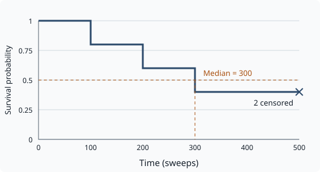

# Statistical analysis

[Home](../README.md) · [Experiments](experiments.md) · [Observables](observables.md)

The analysis package operates on recorded observations independently of the simulation and CLI. Its estimators are descriptive unless their statistical assumptions are justified.

## Right-censored stopping times

For a stopping time $\tau_N$, the survival function is $S_N(t)=\mathbb P(\tau_N>t)$. A trajectory that reaches its observation limit without an event is right censored. At distinct observed times $t_j$, let $r_j$ denote the number at risk immediately before $t_j$ and $d_j$ the number of observed events there. The Kaplan–Meier estimator is

$$\widehat S_N(t)=\prod_{t_j\leq t}\left(1-\frac{d_j}{r_j}\right).$$

Tied events and censorings use the same risk set, then both leave it. The estimator assumes independent trials and noninformative censoring, as in independently seeded trials with fixed observation limits.

```python
from ising.analysis import kaplan_meier, median_survival, restricted_mean

curve = kaplan_meier([100, 200, 300, 500, 500], [1, 1, 1, 0, 0])
print(median_survival(curve))       # 300.0
print(restricted_mean(curve, 500))  # 320.0
```



`kaplan_meier` returns rows containing `time`, `at_risk`, `events`, `censored`, `survival` and `se` (Greenwood standard error). These standard errors are asymptotic, not exact confidence bounds; the implementation gives zero at complete extinction. The median is the first time survival is at most one half, or `None` if not identified. The restricted mean integrates survival to a specified horizon within observed follow-up:

$$\operatorname{RMST}(u)=\int_0^u\widehat S_N(t)\,dt.$$

Do not substitute the cutoff for a missing median or extrapolate the tail beyond follow-up.

## Finite-size scaling

A descriptive fit to characteristic times has form

$$\log\widehat\tau_N\approx cN+b.$$

`exponential_fit` performs unweighted linear regression on log times using at least three distinct positive sizes and positive finite characteristic times. It returns `rate`, `intercept`, `r_squared` and `regression_se`. The regression standard error does not propagate uncertainty in the estimated times or censoring; it is not a validated uncertainty estimate for an asymptotic exponential rate.

After running the passage command in [Experiments](experiments.md#first-passage-experiments):

```python
import csv
from ising.analysis import passage_medians, exponential_fit

with open("results/nucleation/trials.csv", newline="") as f:
    rows = list(csv.DictReader(f))
medians = passage_medians(rows)
print(medians)
valid = [r for r in medians if r["median"] is not None and r["median"] > 0]
if len(valid) == len(medians) and len(valid) >= 3:
    print(exponential_fit([r["N"] for r in valid], [r["median"] for r in valid]))
else:
    print("No fit: insufficient sizes or unidentified/nonpositive medians")
```

`passage_medians` checks recorded model and algorithm signatures (`beta`, `lambda`, `dynamics`, `backend`, `init`, `threshold`). Analyze one fixed-parameter study at a time, and inspect censoring and limits. A finite-size trend does not establish convergence of $N^{-1}\log\tau_N$ or a mixing-time lower bound.

## Temporal autocorrelation

For equally spaced stationary observations $X_0,\ldots,X_{n-1}$ with sample mean $\bar X$, the FFT implementation computes

$$\widehat\rho(k)=\frac{\sum_{i=0}^{n-k-1}(X_i-\bar X)(X_{i+k}-\bar X)}{\sum_{i=0}^{n-1}(X_i-\bar X)^2}.$$

`integrated_time` uses the initial positive sequence of adjacent lag pairs, starting at $(\rho(0),\rho(1))$, and subtracts one half. The estimate has a floor of half a sample interval. The convention corresponds to $\tau_{\rm int}=\tfrac12+\sum_{k\geq1}\rho(k)$; multiply by the recording interval for sweep units. Constant trajectories have undefined correlation. Use adequate stationary sampling rather than short metastable transients.

```python
from ising import IsingModel
from ising.experiments import run
from ising.analysis import autocorrelation, integrated_time

# Illustrative workflow; check equilibration before interpreting results.
_, observations = run(IsingModel(16, .3, 3), 1000, record_every=5)
values = [r["magnetization"] for r in observations[101:]]
rho = autocorrelation(values, max_lag=20)
print(5 * integrated_time(rho))
```

## Spatial height correlations

For rectangular height profiles, subtract the pooled mean of all valid heights. At lag $k$, average products of centered heights over valid pairs separated by $k$, then divide by the pooled variance. Missing rays are excluded, not imputed. `height_correlation` returns `lag`, `pairs`, `covariance`, `correlation`; undefined values are `None`.

```python
from ising.analysis import height_correlation

profiles = [[2, 3, None, 4, 3], [3, 4, 5, 4, 3]]
print(height_correlation(profiles, max_lag=2))
```

For simulation data, collect `row["interface_heights"]["top"]["heights"]` from trajectory observations with `interface_heights=True`. Use consistent trimming, adequate coverage and formed droplets; consider corner effects and spatial inhomogeneity. A single profile is not enough for equilibrium uncertainty estimates.

## Uncertainty estimates

`batch_mean(x, nb=20)` splits a trajectory into `nb` contiguous equal-sized batches, discards the incomplete tail, and returns the mean and sample standard deviation of batch means divided by $\sqrt{nb}$ (the latter is the standard error). Batches should exceed correlation scales; burn-in and stationarity need separate assessment.

`bootstrap_mean` resamples independent observations with replacement and returns a percentile interval for their mean. Do not apply it directly to correlated MCMC samples or censored stopping times.

```python
from ising.analysis import batch_mean, bootstrap_mean

print(batch_mean([1, 2, 3, 4, 5, 6], nb=3))
print(bootstrap_mean([1, 2, 3, 4, 5, 6], seed=42))
```

These tiny arrays illustrate the interface, not reliable uncertainty estimates.

## Further reading

- E. L. Kaplan and P. Meier, *Nonparametric estimation from incomplete observations* (1958).
- C. J. Geyer, *Practical Markov Chain Monte Carlo* (1992).
