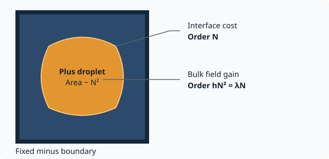

# Mathematical model

[Home](../README.md) · [Dynamics](dynamics.md) · [Observables](observables.md)

## Domain and boundary conditions

Let $\Lambda_N=\{1,\ldots,N\}^2$ and let $\sigma\in\{-1,+1\}^{\Lambda_N}$. Extend the configuration to $\Z^2$ by setting every exterior spin to $-1$. The coupling constant is $J=1$, and the bulk magnetic field is $h_N=\lambda / N$, $\lambda \geq 0$.

Let $E_N$ be the set of unordered nearest-neighbor edges with at least one endpoint in $\Lambda_N$. Each edge is counted once; fixed-fixed edges are excluded. There are $2N(N+1)$ such edges.

## Energy and equilibrium measure

The Hamiltonian is 
$$H_N(\sigma)=-\sum_{\{x,y\}\in E_N}\sigma_x\sigma_y-h_N\sum_{x\in\Lambda_N}\sigma_x.$$

At inverse temperature $\beta>0$, the Gibbs measure is

$$\pi_{N,\beta,\lambda}(\sigma)=\frac{e^{-\beta H_N(\sigma)}}{Z_{N,\beta,\lambda}},\qquad Z_{N,\beta,\lambda}=\sum_\sigma e^{-\beta H_N(\sigma)}.$$

The zero-field infinite-volume critical inverse temperature is

$$\beta_c=\tfrac12\log(1+\sqrt{2})\approx0.440687.$$

The regime of interest is at temperatures below the critical point $\beta>\beta_c$. The simulator accepts any finite positive inverse temperature. 

## Why the field scales as $1/N$



At low temperature, a macroscopic plus droplet has area of order $N^2$, which means that the energy gain due to the field is of order $h_N N^2= \lambda N$, and interface free-energy (surface tension) cost is of order $N$. Thus the two contributions compete at a fixed positive $\lambda$ as the size of the domain grows. This motivates studying droplet formation and dissolution, metastability and boundary-layer fluctuations. 

## Python representation

```python
from ising import IsingModel

model = IsingModel(N=64, beta=0.5, lam=3)
print(model.h)  # 0.046875
```

`IsingModel` is immutable and contains the parameters `N`, `beta` and `lam`. Dynamics and backend are separate simulator choices. Exact enumeration is available through `ising.exact.exact_small` for $N\leq4$; see the [equilibrium diagnostic](experiments.md#equilibrium-diagnostic).
