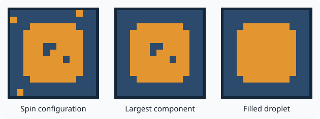
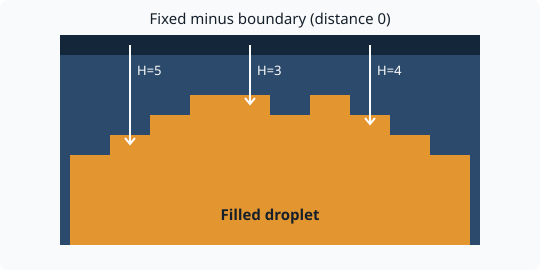

# Observables and geometry

[Home](../README.md) · [Model](model.md) · [Analysis](analysis.md)

Observables measure the current configuration. The package separates thermodynamics, geometric clusters, hole-filled droplet geometry and boundary profiles.

```python
from ising import IsingModel, Simulator

sim = Simulator(IsingModel(64, .5, 3), init="plus", seed=42)
sim.advance(100)
measurements = sim.observe(cluster_details=True, contours=True,
                           boundary_profile=True, interface_heights=True,
                           min_cluster_size=10, trim=8)
```

The default `observe()` includes thermodynamic quantities and the largest cluster fraction. Set `clusters=False` for constant-time local-chain measurements, provided no other geometric options are enabled. Optional geometric measurements share a labeling pass and filled mask when applicable.

## Thermodynamics

Let $M=\sum_{x\in\Lambda_N}\sigma_x$, $B=2N(N+1)$ be the physical edge count, and $L$ be the number of disagreeing physical edges. Fixed-fixed bonds are excluded (see [Model](model.md)).

| Output | Definition |
|---|---|
| `sweep` | Number of sweeps performed |
| `updates` | Number of elementary updates performed |
| `magnetization` | $M/N^2$ |
| `plus_fraction` | $(1+M/N^2)/2$ |
| `interface_length` | $L$ |
| `interaction_energy` | $2L-B$ |
| `field_energy` | $-h_NM$ |
| `energy` | $2L-B-h_NM$ |
| `excess_energy` | $2L-h_N(M+N^2)$, relative to all minus |

The energy values are totals, not per-site averages. `bond_sum` returns $B-2L$ using the same edge set as exact enumeration. Local updates maintain $M$ and $L$ incrementally while cluster steps and state replacement recompute both. $L$ accounts for all thermal interfaces including the microscopic ones, and is not the perimeter of a macroscopic droplet.

## Geometric plus clusters

Use `cluster_details=True`. Let $A_1\geq A_2\geq\cdots$ denote the sizes of northwest-connected plus components. These are geometric clusters, not Fortuin–Kasteleyn bond components.

| Output | Definition |
|---|---|
| `cluster_sizes` | Descending integer component sizes |
| `cluster_count` | Number of components |
| `clusters_above_threshold` | Count with size at least `min_cluster_size` |
| `largest_plus_fraction` | $A_1/N^2$ |
| `second_plus_fraction` | $A_2/N^2$ |
| `second_to_first_ratio` | $A_2/A_1$; `None` if no plus spins |
| `cluster_second_moment` | $N^{-2}\sum_i A_i^2$ |

Missing first or second component sizes are taken as zero for the fraction calculations.

The shared `NW_CONNECTIVITY` structure is `[[0,1,1],[1,1,1],[1,1,0]]`. It adds NE–SW diagonal adjacency for both spin values, equivalent to pairing north–west and south–east dual edges at alternating plaquettes. This is spin-flip symmetric but not invariant under quarter turns. No diagonal physical interactions or FK bonds are added. Historical geometric statistics and thresholds using four-neighbor clusters are not directly comparable. Existing first-passage experiments use magnetization and are unchanged.

## Explicit Peierls contours

`peierls_contours(state)` returns closed arrays of half-integer `(row, column)` coordinates in padded-array units, oriented with plus spins on the right. Total edge length equals `interface_length(state)`. At a degree-four vertex the ordered edge sequence encodes the northwest resolution; raw plots can show touching vertices. The tracer is opt-in and is not called by `observe(contours=True)`, which computes mask geometry only.

## Exterior droplet proxy



With `contours=True`, the largest northwest-connected plus component is selected (ties use the first component in row-major labeling order). Holes are filled with the same connectivity. NE–SW diagonal escape channels remain open; NW–SE-only channels are closed. The filled mask is bounded by the selected component’s external Peierls contour, but is not necessarily the region enclosed by the largest-area contour. It is not a macroscopic phase estimator.

Write $D$ for the filled mask, $A=|D|$, $P$ for the number of edges separating the mask from its complement, and $C$ for the covariance matrix of occupied site coordinates.

| Output | Definition |
|---|---|
| `droplet_area`, `droplet_area_fraction` | $A$, $A/N^2$ |
| `droplet_perimeter`, `droplet_perimeter_scaled` | $P$, $P/N$ |
| `droplet_center` | Mean occupied coordinates (one-based row, column) |
| `horizontal_diameter`, `vertical_diameter` | Bounding-box spans in sites, including endpoints |
| `radius_of_gyration` | $\sqrt{\operatorname{tr} C}$ in lattice units |
| `aspect_ratio` | Square root of larger/smaller covariance eigenvalue |
| `compactness` | $4\pi A/P^2$ |

Perimeter includes edges along the fixed frame. Thin protrusions remain, and the perimeter does not estimate anisotropic surface tension. Empty masks have zero area, perimeter and spans; undefined measurements are `None`. Degenerate covariance gives `None` for aspect ratio.

## Boundary measurements

`boundary_profile=True` returns `boundary_magnetization`, the mean spin on successive square shells, starting with the interior layer adjacent to the fixed frame (distance 1).

`interface_heights=True` returns first-hit distances to the filled droplet from each of the four fixed sides.



For each inward ray, the height is the smallest positive lattice distance to an occupied mask site. A touching droplet has height 1; subtract 1 to count intervening interior sites. A ray with no hit has value `None`, not zero or $N$. Top and bottom rays run left to right; left and right run top to bottom. `trim` removes that many rays at both ends of each side; at least one ray must remain.

Each of `top`, `bottom`, `left`, `right` contains `heights`, `coverage` (fraction of valid rays), `mean`, `variance` (population variance), `minimum` and `maximum`. Moments and extrema condition on valid rays and are `None` if no hits occur.

Compare coverage and restrict attention to formed macroscopic droplets before interpreting conditional heights or pre-wetting scaling. No scaling law is assumed. Full height arrays allow subsequent spatial-correlation analysis but are not automatically collected during passage experiments.
